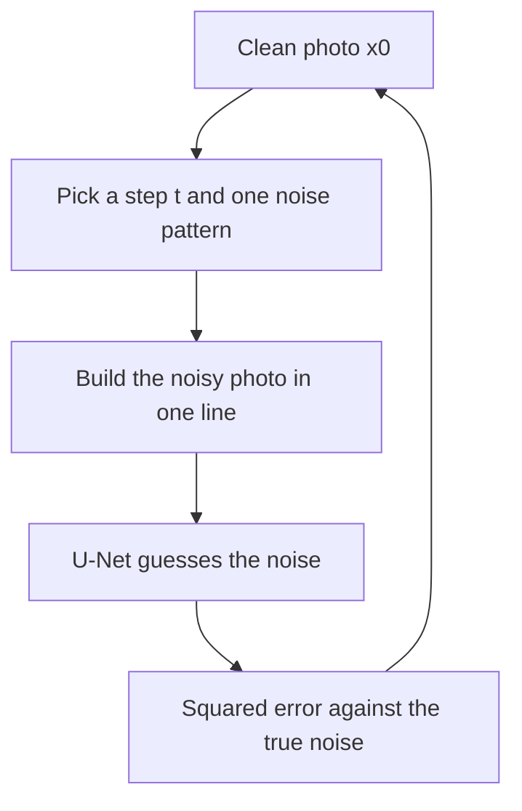
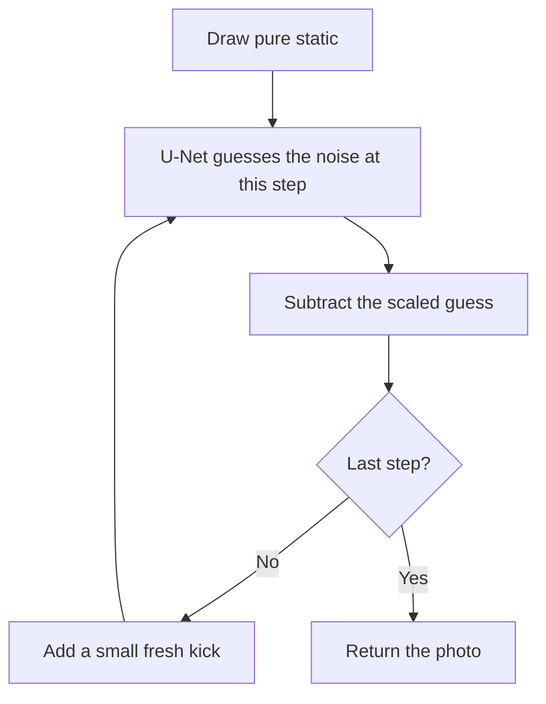

# Notes

The point-by-point account is in the [summary](summary.md). These notes cover five papers as one story: [Sohl-Dickstein et al. 2015](https://arxiv.org/abs/1503.03585), [Song and Ermon 2019](https://arxiv.org/abs/1907.05600), [Ho, Jain, and Abbeel 2020](https://arxiv.org/abs/2006.11239), [Nichol and Dhariwal 2021](https://arxiv.org/abs/2102.09672), and [Dhariwal and Nichol 2021](https://arxiv.org/abs/2105.05233).

Cover a photo in mud, one thin layer at a time, until nothing is left but mud. Learning how to wipe off one layer is much easier than guessing the whole photo in one look. These notes are about the models that draw new photos by wiping static away.

## The one idea that matters

The forward direction is free: fade the photo and mix in a little Gaussian noise, over and over, until only static remains. The reverse direction is the model: a network looks at the noisy photo and the step number, guesses the noise, and you subtract a little of it. Repeat from pure static and a new photo comes out.

## Picture box

- **Mud** = Gaussian noise. One layer is a small \(\beta_t\).
- **Compass** = the 2019 score. It does not guess the mud. It points toward the photos. Large mud uses a coarse compass. Fine mud uses a precise one.
- **Fade** = multiply by \(\sqrt{1-\beta_t}\), so the numbers stay a normal size while the mud goes on.
- **One spoon of mud, from the clean photo** = the shortcut with \(\bar\alpha_t\). You do not stack a thousand layers during training. You jump to step \(t\) with one random pattern \(\varepsilon\).
- **The washcloth** = the U-Net. It does not redraw the photo. It guesses the mud, and you wipe that guess off.
- **The clock** = the step number, told to the network with a sine-and-cosine code, because early mud and late mud need different wipes.
- **A second person pointing** = classifier guidance. Someone outside the washcloth says "make it more like a dog" while you wipe.

Put the pictures together. Stack mud to hide the photo. In training, jump to a random layer with one spoon and ask the washcloth which mud it sees. When drawing, start from a lump of mud and wipe, one layer at a time, with a tiny fresh splatter between wipes so each run can come out different. On the last wipe, do not splatter.

## Paper map

1. **2015, the idea.** Forward diffusion turns any data into a simple bell curve. The reverse is a chain of small bell curves. Learning those curves is regression. The model can also denoise and inpaint by nudging each reverse step.
2. **2019, the compass.** Song and Ermon learn \(\nabla_x \log q_\sigma(x)\) at ten noise widths, from 1 down to 0.01, with one network. Training matches the arrow \(-(\tilde x - x)/\sigma^2\). Drawing starts in heavy noise and walks downhill in noise: step, then a smaller \(\sigma\). For Gaussian noise that arrow is \(-\varepsilon/\sigma\), which is why 2020 can train on \(\varepsilon\) directly.
3. **The one-step formula.** \(x_t = \sqrt{1-\beta_t}\, x_{t-1} + \sqrt{\beta_t}\,\varepsilon\). Center is the faded pixel. Width comes from \(\beta_t\).
4. **The shortcut.** \(\alpha_t = 1-\beta_t\), \(\bar\alpha_t = \alpha_1\cdots\alpha_t\), and \(x_t = \sqrt{\bar\alpha_t}\, x_0 + \sqrt{1-\bar\alpha_t}\,\varepsilon\).
5. **2020, predict the noise.** The honest likelihood is intractable. A variational bound, conditioned on \(x_0\), becomes mean squared error on \(\varepsilon\). The width stays on the schedule. The loss weight that depends on \(t\) is dropped.
6. **The U-Net.** Down, then up, with skip connections, a few attention blocks, and the timestep mixed into the blocks. Pixels are scaled from 0…255 into −1…1.
7. **2021, Nichol and Dhariwal.** Learn a mix between two widths. Add the bound back with weight 0.001. Replace the linear schedule with a cosine schedule so the photo is not destroyed too fast.
8. **2021, Dhariwal and Nichol.** Deeper U-Net, more attention, BigGAN residual blocks, adaptive group norm for timestep and class, classifier guidance, then upsampling. ImageNet 256 FID: improved DDPM **12.3**, ADM **4.59**, ADM with upsampling **3.94**. Lower is better.

## One pixel, all the way through

The clean value is 0.8. At a late-middle step the combined fade \(\sqrt{\bar\alpha_t}\) is 0.6, so the leftover noise scale is 0.8. The random draw \(\varepsilon\) is 0.5.

```text
noisy = 0.6 × 0.8 + 0.8 × 0.5
      = 0.48 + 0.40
      = 0.88
```

The network sees 0.88 and the step number. It does not see 0.5. Training nudges it until it says something very close to 0.5. Drawing has no saved 0.5. The network's guess is subtracted, a small new kick is added, and the pixel takes one step toward a finished photo.



## How a new photo is drawn



## Takeaways

- The idea to explain to someone else: hide the photo in noise, then learn to remove that noise a little at a time. A new photo is what you get when you start from noise and do the removal.
- The 2019 idea to keep beside the wipe: you can draw by following "which way is more likely," and you need that arrow at many noise levels or the walk gets lost between kinds of photos.
- The shortcut worth remembering: you can build the noisy photo at any step from the clean photo and one noise pattern. Training is "guess that pattern."
- The evidence: the 2015 samples are blurry. Predicting the noise in 2020 makes diffusion a serious image model. By the fourth paper, ImageNet 256 FID is 3.94 with upsampling.
- What these notes still treat lightly: the full algebra from the likelihood to the squared error, and how classifier guidance changes the reverse step.

## What I still don't understand

- Why dropping the step-dependent weight in front of the squared error makes samples look better.
- How \(\beta_t\) and \(\tilde\beta_t\) are derived, before the network mixes them with the knob \(v\).
- What the classifier adds, exactly, inside one reverse step.
- Why the compass near one cluster of photos ignores how common that cluster is, unless the walk starts from a much noisier picture.
