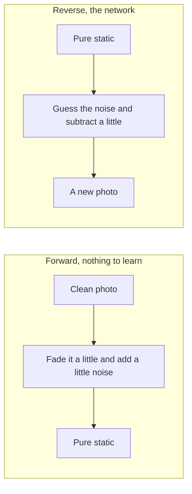

# Summary

The picture and the walkthrough are in the [notes](notes.md). These notes cover five papers as one story, the way the Outlier video teaches the diffusion papers, plus the score-based paper that sits between the first two: [Sohl-Dickstein et al. 2015](https://arxiv.org/abs/1503.03585), [Song and Ermon 2019](https://arxiv.org/abs/1907.05600), [Ho, Jain, and Abbeel 2020](https://arxiv.org/abs/2006.11239), [Nichol and Dhariwal 2021](https://arxiv.org/abs/2102.09672), and [Dhariwal and Nichol 2021](https://arxiv.org/abs/2105.05233).

Picture a photo covered in a thousand thin layers of mud. Wiping one layer off is a small job. Guessing the photo from the fully covered lump, in one try, is a hard job. A diffusion model learns the small job. Add mud until the photo is gone. Then learn to wipe one layer at a time, starting from pure mud, until a new photo appears.

## What the story is about

- A diffusion model invents new images. Training shows it real photos. Drawing starts from random static and slowly turns that static into a new photo.
- The 2015 paper introduces the idea, from physics: destroy structure with a forward diffusion, then learn the reverse diffusion.
- The 2019 paper does not learn a reverse bell curve. It learns an arrow, the score. At a picture, the arrow points toward "more like the training photos." Drawing is a walk along those arrows. Several noise levels make the arrows well-defined.
- The 2020 paper (DDPM) makes the pictures sharp. The network predicts the noise. The training loss becomes mean squared error.
- The 2021 papers learn the width of each reverse step, slow down how fast the photo is destroyed, deepen the network, and steer the subject with a class label or a separate classifier.

## The forward direction

- Nothing is learned. Start from the clean photo \(x_0\).
- One step shrinks the current picture and mixes in Gaussian noise. \(\beta_t\) is a small knob between 0 and 1. It sets how much noise this step adds.

\[
x_t = \sqrt{1-\beta_t}\, x_{t-1} + \sqrt{\beta_t}\,\varepsilon
\]

- The first term fades the picture toward 0. The second term is the kick. \(\varepsilon\) is ordinary static, mean 0, variance 1.
- The fade keeps the size of the numbers steady. Fading removes a bit of spread. The kick puts that same spread back. After enough steps the original photo is gone and only a standard bell curve is left.
- A smaller index is a cleaner picture. \(x_T\) is pure static. Early papers use \(T = 1000\).

## Landing on any step in one line

- Repeating the step \(t\) times is slow, and it leaves a pile of separate kicks.
- Set \(\alpha_t = 1 - \beta_t\). Set \(\bar\alpha_t\) to the product \(\alpha_1 \alpha_2 \cdots \alpha_t\). That product is the combined fade.

\[
x_t = \sqrt{\bar\alpha_t}\, x_0 + \sqrt{1-\bar\alpha_t}\,\varepsilon
\]

- Early on, \(\bar\alpha_t\) is near 1, so the photo still shows. Late, \(\bar\alpha_t\) is near 0, so the picture is noise.
- Training uses this shortcut. Pick a real photo, a random step, and one noise pattern. Build \(x_t\) in one line. Ask the network to recover \(\varepsilon\).

## The reverse direction

- \(p(x_{t-1} \mid x_t)\) is a bell curve. A bell curve needs a center and a width.
- The 2015 model learns both, with a small network at each step.
- The 2020 model locks the width to the schedule and lets the network predict the noise \(\varepsilon\). The center is then built from the noisy picture and that guess:

\[
\text{center} = \frac{1}{\sqrt{\alpha_t}}\left(x_t - \frac{\beta_t}{\sqrt{1-\bar\alpha_t}}\varepsilon\right)
\]

- Subtract a scaled copy of the guessed noise. If this is not the last step, add a small fresh kick so different runs can make different photos. On the last step, skip the fresh kick.

## The 2019 arrow

- The score of a picture is \(\nabla_x \log p(x)\). It is the direction in which the log of the probability climbs fastest. A network \(s_\theta(x)\) is trained to match that arrow. The probability itself is never written down.
- Plain score matching needs the slope of the network, which is too expensive for images. Denoising score matching adds Gaussian noise of width \(\sigma\) and matches an arrow that has a formula. If the clean photo is \(x\) and the noisy one is \(\tilde x\), the true arrow is \(-(\tilde x - x)/\sigma^2\).
- Real photos sit on a thin surface in pixel space. On that surface the arrow is undefined, and far from the photos there is no training data, so the arrow is a bad guess. A walk that only uses the clean-data arrow also cannot tell a common kind of photo from a rare one, because the arrow near each cluster does not carry the cluster's weight.
- The fix is a Noise Conditional Score Network. One network takes the picture and a noise level \(\sigma\). The levels are a geometric ladder, \(L = 10\), from \(\sigma = 1\) down to \(\sigma = 0.01\). Large \(\sigma\) fills the empty space. Small \(\sigma\) is almost the real photo. Each level is weighted by \(\lambda(\sigma) = \sigma^2\), so a big arrow at small noise does not drown out the others.
- Sampling is annealed Langevin dynamics. Start from uniform noise. At the largest \(\sigma\), repeat

\[
\tilde x \leftarrow \tilde x + \frac{\alpha}{2} s_\theta(\tilde x, \sigma) + \sqrt{\alpha}\, z
\]

  for \(T = 100\) steps, with \(z\) ordinary static. Then drop to the next smaller \(\sigma\) and continue from the picture you have. The step size shrinks with \(\sigma\): \(\alpha_i = \epsilon \sigma_i^2 / \sigma_L^2\), and \(\epsilon = 2 \times 10^{-5}\).
- The bridge to 2020: for this Gaussian noise, the true arrow is \(-\varepsilon / \sigma\). Guessing the arrow and guessing the noise are the same job. DDPM keeps the guess and replaces the annealed walk with the reverse chain.

## Why the loss looks like a detour

- The honest goal is the probability of real training photos. That sum runs over every noise path and cannot be computed.
- The computable stand-in is a variational lower bound, the same family of bound used for a VAE. The gap is a KL divergence, which is never negative.
- Conditioning on the clean photo \(x_0\) makes "what was the previous step?" a tight question. That reverse step has a closed form. It is another bell curve.
- Matching the network's bell curve to that closed form, then rewriting the center in terms of \(\varepsilon\), leaves mean squared error between the true noise and the guessed noise.
- A scaling factor in front of that error depends on the step. The 2020 paper drops it. Samples look better, and the code is simpler.
- The whole training step is: real photo, random \(t\), random \(\varepsilon\), build \(x_t\), predict \(\varepsilon\), squared error.

## The network

- A U-Net takes the noisy picture and returns a noise guess of the same size.
- The down path shrinks the picture and sees larger regions. The up path grows it back. Skip connections carry fine detail across the U.
- Attention at a few sizes lets a pixel look at distant pixels.
- The step number is fed in with the sine-and-cosine position code from Transformers, because step 10 and step 900 must remove different amounts of noise.
- Photos are scaled from 0…255 into −1…1 so they sit on the same range as the starting static.

## What each later paper changes

- **2020 schedule.** \(\beta_t\) rises in a straight line from 0.0001 to 0.02. The photo becomes unrecognizable early, and the last many steps all look like finished static.
- **Improved DDPM, Nichol and Dhariwal.** The width is no longer frozen. The network predicts a knob \(v\) between 0 and 1 that mixes two known widths, \(\beta_t\) and \(\tilde\beta_t\). The noise loss does not see this knob, so a small copy of the variational bound is added with weight \(\lambda = 0.001\). The noise schedule becomes a cosine: flat at the start and the end, dropping through the middle, so the photo survives longer.
- **ADM, Dhariwal and Nichol.** The U-Net gets deeper and a bit narrower, more attention heads, and residual blocks from BigGAN. Adaptive group norm mixes the timestep and the class label into each block. Classifier guidance uses a separate classifier to push the reverse walk toward a chosen category, such as "dog." An upsampling diffusion stage raises resolution after the main model.

## What they found

- 2015: the swiss roll and a binary heartbeat are learned cleanly. Dead-leaves log likelihood beats the previous best. CIFAR-10 samples exist and are blurry. MNIST is in the same range as other 2014–2015 generators.
- 2019: CIFAR-10 inception score **8.87**, then the best unconditional number they compare, and FID **25.32**. Samples on MNIST, CelebA (32×32), and CIFAR-10 look competitive with GANs. Inpainting works. One noise level and a plain walk do not.
- 2020: predicting noise, with the simplified squared-error loss, is the jump in sample quality.
- On ImageNet 256×256, lower FID is better. Improved DDPM scores 12.3. ADM scores 4.59. ADM with upsampling scores 3.94. In the video's chart a GAN still leads, and these diffusion models sit near the front of the pack. The video is from June 2022.

## One line to remember

Add noise until the photo is gone, then train a network to guess that noise and subtract it a little at a time, starting from static.
