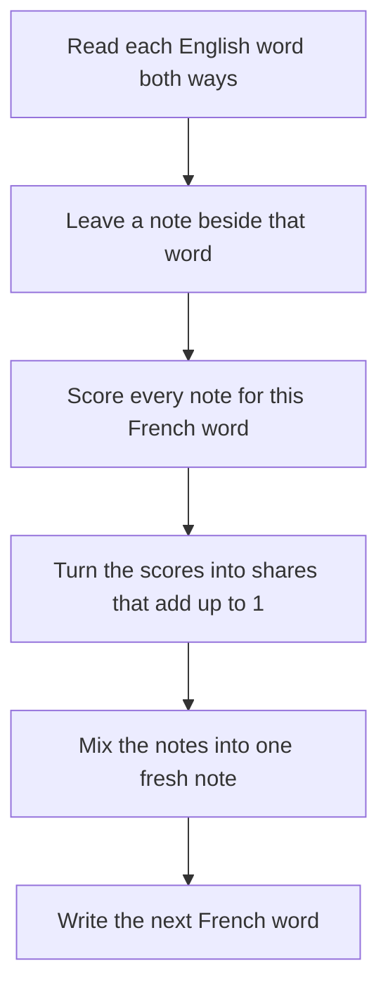

# Notes

The point-by-point account is in the [summary](summary.md). The paper is [Neural Machine Translation by Jointly Learning to Align and Translate](https://arxiv.org/abs/1409.0473).

Read a long English sentence one time. Close the page. Write it in French without looking back. You still remember the ending. You forget the middle. You mix up the names. Old translation programs had to work this way. They could not look at the English again. These notes are about the paper that lets them look back.

The paper is [Neural Machine Translation by Jointly Learning to Align and Translate](https://arxiv.org/abs/1409.0473).

## The one idea that matters

Old translators had to carry the whole English sentence in one breath. A short sentence survived. A long one spilled. This paper lets the writer glance back, and glance at a different part of the English for each French word. That glance is attention, also called soft alignment. The same lesson that teaches the model to translate also teaches it where to look.

## Picture box

- **Sticky note** = the old fixed-length vector
- **Peeking / flashlight** = attention (look more at some words, less at others)
- **Two-way walker** = the bidirectional encoder (reads left-to-right and right-to-left)
- **One team, one grade** = joint training (alignment and translation learn together)

Put the four pictures together. The sticky note was the whole sentence. The flashlight picks which notes matter for the French word being written now. The two-way walker writes each note so it knows the words on both sides. One team, one grade: looking and translating learn from the same score.

## Paper map

1. **Neural machine translation.** One network, one goal: maximize \(p(y \mid x)\), not a pipeline of separately tuned statistical pieces.
2. **Encoder–decoder baseline.** The encoder RNN ends at one vector \(c = h_{T_x}\). The decoder generates every target word from that same \(c\).
3. **Attention.** Each target step \(i\) gets its own \(c_i = \sum_j \alpha_{ij} h_j\). \(\alpha_{ij}\) is a softmax over how well decoder state \(s_{i-1}\) matches source annotation \(h_j\).
4. **Bidirectional encoder.** Each \(h_j\) concatenates a forward and a backward hidden state, so it sees left and right context around word \(j\).
5. **Joint training.** Alignment is a small neural net, not a hidden variable inferred on the side. The translation loss backpropagates through the attention weights.
6. **Results (WMT 2014 English→French).** RNNsearch-50 BLEU **26.75** versus the baseline **17.82** on all sentences. On sentences with only known words, **34.16**, near Moses at **35.63**. Quality holds on long sentences. The baseline collapses.
7. **Open problem they name.** Unknown and rare words.

## How attention works

When the machine writes the next French word, it does not use one sticky note for the whole English sentence. It makes a fresh little note for this word, by peeking more at some English words and less at others.

1. The reader first makes a row of notes, one near each English word. Each note knows that word plus some of the words around it, because the two-way walker has gone left-to-right and right-to-left.
2. Before writing French word \(i\), the writer looks at what it has already said (\(s_{i-1}\)) and scores every English note: “How useful are you right now?”
3. Those scores become shares that add up to 100% (softmax). The share for English word \(j\) is \(\alpha_{ij}\).
4. The fresh note is a mix: \(c_i = \sum_j \alpha_{ij} h_j\). A word with a big share counts more in the mix.
5. The writer uses that mix, plus the last French word, to write the next word.

Why this is the heart of the paper:

- The old machine used one note \(c\) for every French word. Here each French word gets its own note \(c_i\).
- Peeking is soft. It can look at “the” and “man” at once, which helps pick “l’” versus “le.”
- Peeking is trained with translation. Nobody draws the matches by hand. The same “did I write good French?” grade teaches the peeking too.

## The history paragraph, in easy language

Neural nets were already used in translation, but only as a helper, not as the whole translator.

Bengio et al. (2003) built a neural language model. It answers “what word comes next?” A neural net reads a fixed number of previous words (a short window, not the whole sentence) and outputs chances for the next word. Words became lists of numbers, so similar words could share meaning instead of living in separate count bins.

After that, people put neural nets inside the old translation factory in two common ways:

1. **One extra feature.** The statistical system still scores a translation with many knobs. The net adds one more score. The old system still runs the show.
2. **Re-rank a list.** The old system writes, say, the 100 best French drafts. A neural net re-orders that list. The net never writes the sentence from scratch.

Bahdanau, Cho, and Bengio want the opposite: one network that reads the source and generates the translation.

## Takeaways

- The idea to explain to someone else: translation got better because the model learns where to look while it writes, instead of remembering the whole source in one vector.
- The evidence: on WMT 2014 English→French, RNNsearch-50 scores **26.75** BLEU against the old model’s **17.82**. The old model falls apart as sentences get long. RNNsearch holds up.
- What the paper still cannot do: unknown and rare words. On sentences with only known words it gets close to Moses (**34.16** vs **35.63**). With unknown words in the mix, it does not.

## What I still don't understand

- Why the match \(a(s_{i-1}, h_j)\) needs a small scoring network, instead of a simpler comparison between the two vectors.
- How beam search chooses among drafts once every French word has its own mix \(c_i\).
- Why looking at the right English words still cannot name a rare word that was replaced by `[UNK]`.
