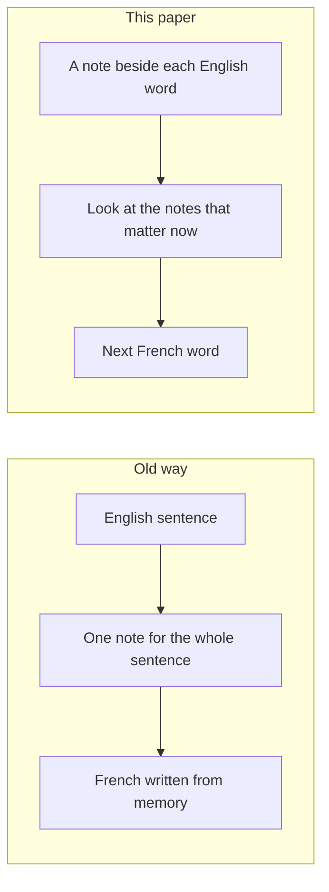

# Summary

The picture and the walkthrough are in the [notes](notes.md). The paper is [Neural Machine Translation by Jointly Learning to Align and Translate](https://arxiv.org/abs/1409.0473).

Picture a small piece of paper. It can hold only a few words, and it is the same size every time. An old translation program had to copy a whole English sentence onto that paper. Then it wrote the French. It was not allowed to look at the English again. It could use only the words on the paper.

“The cat sat” is short, so every word fits. A long sentence has many names and details. The paper is still the same small size, so some English words are left off. Those missing words never appear in the French.

This paper gives the program one piece of paper for each English word. When the program is about to write one French word, it can look back and read the English words it needs. Looking back like that is called attention.

What follows is a point-by-point account of [Neural Machine Translation by Jointly Learning to Align and Translate](https://arxiv.org/abs/1409.0473), by Dzmitry Bahdanau, Kyunghyun Cho, and Yoshua Bengio (ICLR 2015).

## What the paper is about

- One neural net reads English and writes French.
- Older neural translators (encoder–decoder) read the whole English sentence, squash it into one fixed-size vector, then write French from that vector.
- That one vector is a bottleneck. Long sentences do not fit, so quality drops as length grows.
- The fix: keep a note next to each English word. When writing the next French word, look back at the notes that matter right now.

## How the old model works

- An encoder RNN reads word by word and updates a hidden state. The usual choice is to keep the last hidden state as “the whole sentence.”
- The decoder is a language model steered by that same vector at every step.
- Training maximises \(p(\text{French} \mid \text{English})\). At test time, beam search looks for a high-probability translation.

## What they add (attention / alignment)

- Each French word \(i\) gets its own context \(c_i\), not one shared \(c\).
- \(c_i\) is a mix of source notes: \(c_i = \sum_j \alpha_{ij} h_j\).
- \(\alpha_{ij}\) means “how much should I look at English word \(j\) while writing French word \(i\)?” A small scoring net produces a score, then softmax makes the weights positive and adds them up to 1.
- That is soft alignment: the model can look at several words at once.
- Alignment is not a separate preprocessing step. The same “was this a good translation?” objective trains the peeking together with reading and writing.

## How they encode each English word

- A forward RNN sees the left context. A backward RNN sees the right context.
- They concatenate those two hidden states into \(h_j\). Each note is focused on word \(j\) and knows both sides.
- The decoder’s attention then picks from this row of notes.

## Why this is better

- The encoder no longer has to pack everything into one vector that must work for every French word.
- Soft alignment can handle word-order swaps, such as “European Economic Area” → “zone économique européenne,” and phrases of different lengths.
- For “the man” → “l’ homme,” choosing *l’* depends on the noun after “the.” Looking at both words helps. A hard one-to-one alignment would miss that.

## What they ran

- English to French, WMT 2014. They select a subset of about 348 million words. Vocabulary is 30,000 words; anything else is `[UNK]`.
- Baseline: RNNencdec. Their model: RNNsearch. They train on sentences of up to 30 or 50 words.
- Gated hidden units, Adadelta, about five days of training, beam search at test time.

## What they found

- RNNsearch beats RNNencdec in every setting they report.
- The gap is especially clear on long sentences. The old model falls apart. RNNsearch-50 stays strong even past length 50.
- On sentences with no unknown words, they get close to Moses, even though Moses also used extra monolingual data they did not use.
- The attention heat maps look linguistically sensible: mostly diagonal for English–French, with real reorderings where French needs them.

## How this sits in history

- After Bengio et al. (2003), neural nets in machine translation were mostly one extra score inside a statistical system, or a re-ranker of that system’s n-best list.
- This paper wants the net to write the translation itself.
- Graves’s handwriting attention mostly moves forward. Translation needs jumps, so they score every source word at every target step.

## What they still cannot do well

- Unknown and rare words. They name that as the main remaining gap versus strong statistical machine translation.

## One line to remember

Translation quality went up because the model learns where to look while it writes, instead of trying to remember the whole source in one vector.
