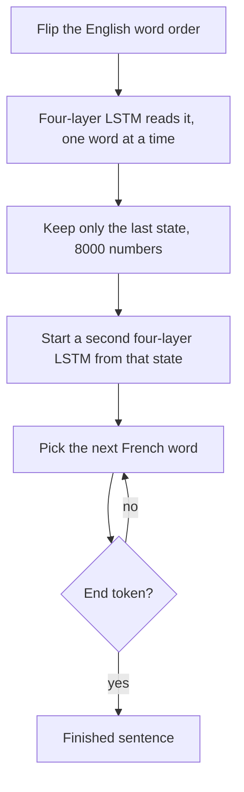

# Notes

The point-by-point account is in the [summary](summary.md). The paper is [Sequence to Sequence Learning with Neural Networks](https://arxiv.org/abs/1409.3215).

Read an English sentence onto one index card. Hand the card to someone who does not speak English, and ask them to write the French. They cannot look back at the page. They stop when they think the sentence is done. These notes are about the paper that shows a deep LSTM can be that card, if you let it read the English backwards.

The paper is [Sequence to Sequence Learning with Neural Networks](https://arxiv.org/abs/1409.3215).

## The one idea that matters

One LSTM reads the whole source and keeps a single fixed vector. A second LSTM writes the target from that vector and stops on an end marker. Reversing the source words puts the start of the English next to the start of the French, so learning the link is a short jump instead of a long one.

## Picture box

- **Index card** = the fixed vector \(v\), the encoder’s last hidden state
- **Two desks** = two separate LSTMs, one for English and one for French
- **Reading the page backwards** = reversing the source, not the target
- **Stop sign** = `<EOS>`, which lets the French be a different length from the English

Put the four pictures together. The reader walks the English backwards and leaves one card. The writer starts from that card and writes until the stop sign. The backwards walk is why the first words on each side can talk to each other during training.

## Paper map

1. **The limit of ordinary nets.** They want inputs and outputs whose length is not fixed in advance. Translation is the test, not the only intended use.
2. **Encoder, then decoder.** \(v\) is the last state after the source. Then \(p(y \mid x) = \prod_t p(y_t \mid v, y_{<t})\), a softmax at each step.
3. **Four-layer LSTMs, two of them.** Depth cut perplexity by about 10% per layer. Separate encoder and decoder add parameters cheaply.
4. **Reverse the source.** Perplexity 5.8 → 4.7. Single-model BLEU 25.9 → 30.6.
5. **WMT 2014 English→French.** 12M sentence pairs. Vocabularies 160k English and 80k French. Ensemble of 5 reversed LSTMs, beam 12: BLEU **34.81**, above the phrase-based baseline **33.30**.
6. **Rescoring.** The same ensemble on the baseline’s 1000-best list reaches **36.5**, near the best published system at **37.0**.
7. **The card means something.** PCA of the vectors groups paraphrases and keeps word order. Active and passive land nearby.

## How the translation is produced

1. Training asks the model to make the true French probable given the English. The loss is the average of \(\log p(T \mid S)\) over the training pairs.
2. At test time the true French is unknown. Beam search keeps a few partial translations, extends each by one word, and throws away all but the best \(B\).
3. A hypothesis that emits `<EOS>` leaves the beam and becomes a finished candidate.
4. Beam 2 is enough for most of the gain. Beam 12 is what they use for the headline number.

## The history paragraph, in easy language

Before this, neural nets usually helped an old translation system. They rescored a list the old system had already written, or they added one extra score inside it.

Kalchbrenner and Blunsom compressed a sentence with a convolutional net, which does not keep word order, then generated from that vector. Cho et al. used an encoder–decoder much closer to this one, and mostly plugged it into a statistical system. Graves had shown a network that can look back at parts of its input. Bahdanau, Cho, and Bengio turn that look-back into the translator, because encoder–decoders had been dropping long sentences.

Sutskever, Vinyals, and Le stay with the single card. Their bet is that a deep LSTM, plus English read backwards, can remember a long sentence without looking back.

## Takeaways

- The idea to explain to someone else: read the sentence into one vector, write the other sentence out of it, and reverse the source so the beginnings line up.
- The evidence: on WMT 2014 English→French, five reversed LSTMs score **34.81** BLEU against a phrase-based baseline of **33.30**. Rescoring that baseline’s 1000-best list reaches **36.5**.
- What the paper still cannot do: words outside its lists. Direct translation also still trails the best system that uses the old decoder’s drafts.

## What I still don't understand

- Why reversing helps the end of a long French sentence, not only the beginning, if the late French words are still far from their English partners.
- How much of the 8000-number card is actually used, since four layers of 1000 cells are concatenated into that one state.
- Why a beam of 2 is almost as good as a beam of 12, if so many French word choices are still open at each step.
