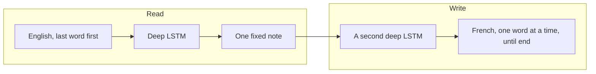

# Summary

The picture and the walkthrough are in the [notes](notes.md). The paper is [Sequence to Sequence Learning with Neural Networks](https://arxiv.org/abs/1409.3215).

Picture two people and one small piece of paper. The first person reads an English sentence, then writes the whole meaning on that paper. The paper is the same size no matter how long the sentence is. The second person never sees the English. They only see the paper, and they write the French from it, one word at a time, until they decide the sentence is finished.

A short sentence fits. A long sentence has to be squeezed. The surprise in this paper is that a careful reader can still squeeze a long sentence well enough to beat a strong old translation system. The trick that makes the squeeze work is reading the English backwards, so the first English words sit next to the first French words.

What follows is a point-by-point account of [Sequence to Sequence Learning with Neural Networks](https://arxiv.org/abs/1409.3215), by Ilya Sutskever, Oriol Vinyals, and Quoc V. Le (NIPS 2014).

## What the paper is about

- Many neural nets need the input and the answer to be vectors of a known, fixed size.
- Translation, speech, and question answering are sequences, and the two sequences can have different lengths.
- The method here makes almost no assumption about how the words line up. One deep LSTM reads the source into one vector. A second deep LSTM writes the target from that vector.
- They try it on English to French from WMT 2014.

## How the model works

- A plain RNN can turn a sequence into a sequence when you already know which input step matches which output step. Translation does not give you that match, and the lengths differ.
- So the encoder reads \(x_1, \ldots, x_T\) and keeps only its last hidden state, a fixed vector \(v\).
- The decoder is a language model whose first hidden state is \(v\). It writes
  \(p(y_1, \ldots, y_{T'} \mid x) = \prod_t p(y_t \mid v, y_1, \ldots, y_{t-1})\).
- Each sentence ends with `<EOS>`. That token lets the model stop, so the French can be shorter or longer than the English.
- They use two separate LSTMs, one to read and one to write. They stack four layers. A shallow net was worse: each extra layer cut perplexity by nearly 10%.
- The LSTM formulation is the one from Graves (2013).

## The reverse-English trick

- If you read “a b c” and then write “α β γ”, the word *a* is far in time from *α*. The gap is a long time lag, and that is hard to learn.
- They reverse only the source. The model sees “c b a” and writes “α β γ”. Now *a* sits next to *α*.
- The average distance between matched words does not change. The shortest gap does. Backpropagation can “establish communication” between the two sentences.
- Test perplexity fell from 5.8 to 4.7. Decoded BLEU rose from 25.9 to 30.6.
- They expected the early French words to get better and the late ones to get worse. Long sentences got better too, which they read as better use of the LSTM’s memory.

## What they ran

- WMT 2014 English to French. A selected subset of 12 million sentences: 304 million English words and 348 million French words. Same subset as the public baseline they compare to.
- Source vocabulary 160,000 words. Target vocabulary 80,000. Anything else is `UNK`.
- Four layers, 1000 cells per layer, 1000-dimensional word embeddings. The sentence vector is 8000 numbers. About 384 million parameters, of which 64 million are the recurrent connections.
- Softmax over the 80,000 French words at every step. No sampling trick.
- Training maximizes the average log probability of the correct translation. SGD, no momentum, learning rate 0.7, halved every half epoch after epoch 5, for 7.5 epochs. Batches of 128, grouped so sentences in a batch have similar length. Gradients are rescaled when their norm exceeds 5. Weights start uniform in \([-0.08, 0.08]\).
- About 10 days on 8 GPUs: four GPUs for the four layers, four for the softmax.
- At test time, left-to-right beam search. A beam of 1 already works. A beam of 2 captures most of the gain.
- They also rescore the baseline’s 1000-best list by averaging the SMT score and the LSTM score.

## What they found

- One reversed LSTM, beam 12: BLEU **30.59**. Without reversing: **26.17**.
- Five reversed LSTMs, different random starts, beam 12: **34.81**. The phrase-based baseline is **33.30**. Bahdanau et al. report **28.45** in their table.
- Beam 2 with the same ensemble is already **34.50**. Beam 1 is **33.00**.
- Rescoring the baseline 1000-best list with the ensemble reaches **36.5**. The best WMT 2014 system, scored their way, is **37.0**. An oracle that picks the best of those 1000 is about **45**.
- The BLEU number is hurt whenever the reference uses a word outside the 80,000-word French list.
- Long sentences do not collapse. Figure 3 shows little drop below 35 words, and only a small drop on the longest ones.
- The fixed vector is a meaning note. In a PCA plot, “John respects Mary” sits near “Mary is admired by John” in spirit: order matters, and active versus passive does not pull the points apart the way a bag of words would.

## How this sits in history

- Kalchbrenner and Blunsom (2013) already mapped a whole sentence to a vector and back, with a convolutional encoder that throws word order away.
- Cho et al. (2014) used a similar encoder–decoder, mainly to rescore a phrase-based system.
- Graves’s attention can look at different parts of the input. Bahdanau, Cho, and Bengio use a version of that for translation, because the plain encoder–decoder had been weak on long sentences.
- This paper’s claim is that a deep LSTM plus reversed source sentences does not need that look-back to handle long sentences, and that the same net can write the translation itself.

## What they still cannot do well

- Words outside the fixed lists. The vocabulary is larger than many earlier neural translators, and it is still closed.
- The model is “relatively unoptimized.” They say a plain softmax, a simple beam, and no extra monolingual data leave room to improve.
- Rescoring still depends on the old system’s 1000 drafts. The direct decoder does not, and it scores lower (**34.81** versus **36.5**).

## One line to remember

A deep LSTM can read a sentence into one vector and write another sentence from it, and reversing the source is what makes that memory easy enough to learn.
